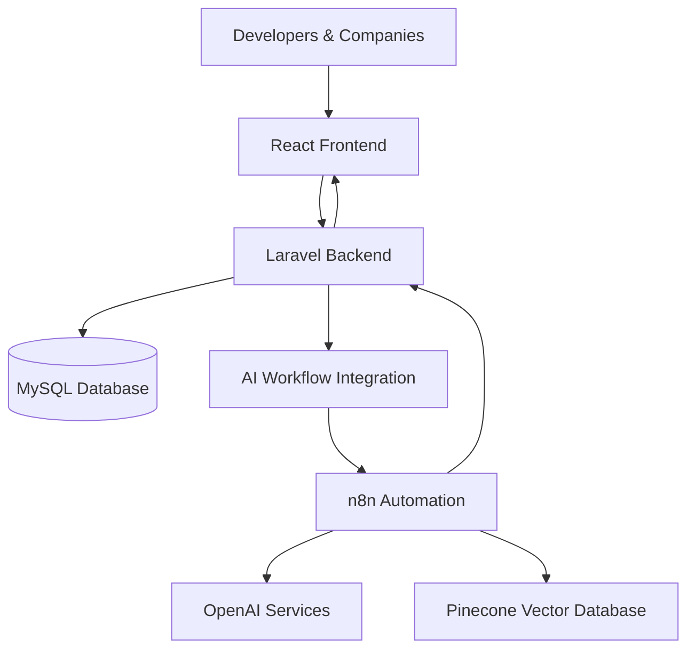

# TechNetwork — AI-Powered Recruitment Platform

### Where Tech Talent Meets Opportunity

**[Live Website](https://technetworkfront.laravel.cloud/)**

---

## Overview

**TechNetwork** is an AI-powered recruitment platform designed specifically for the technology industry.

The platform connects developers and companies through structured developer profiles, job opportunities, and AI-assisted recruitment features.

Developers can showcase their skills, experience, projects, and professional backgrounds, while companies can explore candidates and use intelligent search capabilities to identify relevant talent.

The project explores how AI, semantic search, and workflow automation can improve recruitment beyond traditional keyword-based matching.

> **Note:** This repository serves as a technical showcase of the project. The application source code is maintained separately.

## Key Features

- **Developer Profiles:** Structured professional profiles showcasing skills, experience, projects, and certificates.
- **Job Opportunities:** Company profiles, job postings, and application management.
- **AI-Powered CV Analysis:** AI-assisted CV evaluation with structured feedback and improvement suggestions.
- **Semantic Candidate Search:** Search for developers based on the meaning and context of their skills and experience.
- **Recruitment Assistant:** AI-assisted candidate discovery through natural-language queries.
- **Role-Based Access Control:** Different access levels for platform administrators, companies, and developers.

## My Contributions

**Backend Engineering & AI Integration**

My primary responsibilities focused on backend development, system architecture, and connecting the application with AI-powered services.

- Designed and developed backend services using Laravel and PHP.
- Built RESTful APIs for frontend and external service integration.
- Implemented authentication and dynamic role-based access control.
- Developed database relationships and core application logic.
- Integrated the backend with AI-powered services and automated workflows.
- Connected application features with AI processing capabilities.
- Worked on backend/frontend communication and overall system integration.

## System Overview

TechNetwork combines a Laravel backend, a React frontend, and external AI services supported by automated workflows.

The backend manages application data, authentication, business logic, and communication with AI-related services. Workflow automation handles dedicated AI processing tasks and connects with external AI and vector database services.

## AI Integration

AI capabilities are an important part of the TechNetwork recruitment experience.

The project uses OpenAI services, embeddings, Pinecone, and n8n-based workflow automation to support the following features:

### CV Analysis

AI-assisted processing of uploaded CVs to generate structured evaluations, including strengths, weaknesses, and suggestions for improvement.

### Semantic Candidate Search

Using embeddings and vector search to represent developer profiles and support candidate discovery based on contextual relevance rather than exact keyword matching alone.

### Recruitment Assistant

A natural-language interface that helps companies describe the type of technical talent they are looking for and discover relevant candidate profiles.

**Technologies involved:** OpenAI APIs, OpenAI Embeddings, Pinecone, and n8n.

## Backend & Engineering

The backend is built with Laravel and PHP, with MySQL as the primary relational database.

Key engineering areas include:

- RESTful API development.
- Authentication and session management.
- Dynamic role-based access control.
- Database design and relationships.
- Integration with external services.
- Backend integration with AI workflows.
- Frontend/backend communication.

## Technology Stack

| Area | Technologies |
|---|---|
| Backend | PHP, Laravel |
| Database | MySQL |
| Frontend | React.js |
| Styling | Tailwind CSS, CSS |
| API Communication | REST APIs, Axios |
| Workflow Automation | n8n |
| AI Services | OpenAI APIs, Embeddings |
| Vector Database | Pinecone |
| API Testing | Postman |

## Development Team

TechNetwork was developed as a graduation project at **Al al-Bayt University**, Faculty of Information Technology, Computer Science Department, under the supervision of **Dr. Suhair Bani Ata**.

**Abdalrhman Hamed**
- Backend Engineering
- System Architecture
- REST API Development
- AI Service Integration

**Mohammad Al Bzoor**
- Frontend Development
- AI Workflow Automation
- n8n Workflow Implementation

## Project Links

- **Live Platform:** https://technetworkfront.laravel.cloud/
- **LinkedIn:** [Abdalrhman Hamed](https://www.linkedin.com/in/abdalrhman-hamed-5b929725b)
- **GitHub:** [abood3omar](https://github.com/abood3omar)

---

*TechNetwork explores the intersection of software engineering, AI integration, and modern recruitment workflows.*
